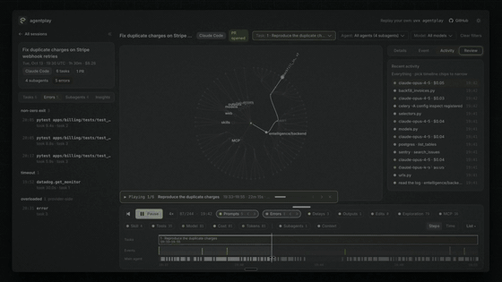
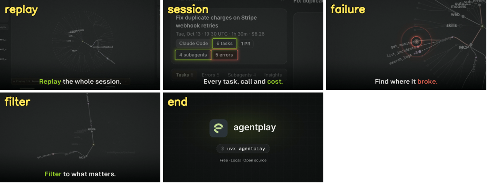

# launchcut

**Turn a raw screen recording into a directed launch video.** Camera moves, highlights, captions, synthesized sound effects and a logo end card, planned shot by shot and checked before you post.



*This 14 s cut came from one 38 s screen recording of [AgentPlay](https://github.com/Entelligence-AI/agentplay). Its whole definition is [`examples/agentplay/cut.yaml`](examples/agentplay/cut.yaml). The GIF is silent; [the MP4 has the sound](docs/agentplay-example.mp4).*

```
recordings + context ──▶ probe ──▶ PLAN.md (beats, shots, pacing) ──▶ cut.yaml ──▶ stills loop ──▶ render + sfx + deliver ──▶ qa
```

## Why

Screen recordings are long, small and silent. A good launch clip has to:

- open on the product,
- land on one idea per shot,
- give the viewer time to read it,
- work muted on a phone,
- and sound alive with the volume up.

launchcut is two things:

- **A playbook, [RULES.md](RULES.md).** A workflow anyone can follow, a person or an AI agent: intake, inventory, beat map, shot list, pacing budget, execution, validation.
- **An engine.** It renders whatever you describe in a small YAML file: designed cameras with motion blur, rings and pulses on the exact UI element, captions, a sound bed generated from what happens on screen, platform-ready encodes, and a QA report.

## What every shot gets



- **Camera:** keyframes with log zoom, or "frame this box". Plus tilt, punch-in entries, whip exits, kicks on state changes, and a dive into the product's own logo that hands off to the end card.
- **Highlights:** rings and pulses placed in recording pixels. They stick to the UI while the camera moves.
- **Captions:** short, with one accent word. `*accent*` for "look here", `!alert!` for failures.
- **Sound:** synthesized and deterministic, with every cue tied to something visible. Whooshes on cuts, hits on landings, pops on highlights, clicks, typing, a beat bed, and narration ducking. A cue sheet tells you why each sound is there.
- **Delivery:** presets for `twitter-16x9`, `twitter-1x1`, `vertical-9x16`, `feed-4x5`, `linkedin-16x9` and `web-16x9`. Each delivery is capped for bitrate and loudness-normalised, with muted and VO-only variants.
- **QA:** gates for codec, size, fps, duration, bitrate, loudness, black frames and the thumbnail frame. Plus review sheets and an editorial checklist for a second pair of eyes.

## Install

You need `ffmpeg`/`ffprobe` on your PATH, and [uv](https://docs.astral.sh/uv/).

```bash
git clone https://github.com/hsrambo07/launchcut && cd launchcut
uv run launchcut --help     # first run installs numpy, opencv-python-headless<5, pillow, pyyaml
```

Fonts: the defaults are [Geist and Geist Mono](https://vercel.com/font) and [Inter](https://rsms.me/inter/). Install them, or point `style.fonts` at any font file. A missing font falls back to a default and prints a warning.

## Make your first video (about 5 minutes of your time)

```bash
# 1. look at what you recorded: specs, audio, contact sheets, the moments where something happens
uv run launchcut probe ~/Desktop/my-recording.mov

# 2. start a cut from the template
uv run launchcut new cuts/my-launch

# 3. find exact pixel boxes for the things you want to highlight
uv run launchcut grid ~/Desktop/my-recording.mov 12.0 --box 0 500 1600 1300

# 4. edit cuts/my-launch/cut.yaml (shots, camera, rings, captions), then preview single frames in seconds
uv run launchcut stills cuts/my-launch/cut.yaml

# 5. render, add sound, encode for the platform, run QA
uv run launchcut all cuts/my-launch/cut.yaml
```

Your files land in `cuts/my-launch/out/`:

- `my-launch.mp4`
- `my-launch-muted.mp4`
- the SFX cue sheet
- `my-launch-qa/report.md`

Read [RULES.md](RULES.md) before directing your first real cut. It covers the judgement calls the engine can't make:

- what to open on,
- how long each beat needs,
- when a caption is redundant,
- how the sound should follow the picture.

[REFERENCE.md](REFERENCE.md) lists every key in `cut.yaml`.

## A cut, in brief

```yaml
name: my-launch
output: {preset: twitter-16x9}
sources: {main: "~/Desktop/my-recording.mov"}

shots:
  - id: reveal                       # frame 0 is the thumbnail: whole product, crisp
    type: ui
    source: main
    duration: 3.5
    src: {start: 14.2, speed: 1.7}
    enter: none
    camera:
      - {t: 0.0, zoom: 0.93}
      - {t: 3.1, frame: [900, 300, 2000, 1100], ease: inOutCubic}
    caption: {text: "*Replay* the whole session.", in: 0.6, out: 3.25}

  - id: proof                        # land, highlight, hold
    type: ui
    source: main
    duration: 2.5
    src: {start: 2.6, speed: 0.5}
    camera: [{t: 0, frame: [40, 200, 900, 700]}]
    rings:
      - {box: [258, 360, 376, 405], at: 0.4}
      - {box: [254, 420, 378, 462], at: 0.8, color: alert}
    caption: {text: "Every task, call and *cost.*", in: 0.25}

  - id: end
    type: end
    duration: 2.75
    lockup: {mark: assets/logo.svg, wordmark: myproduct, width: 800, y: 430}
    command: "npx myproduct"
    tagline: "Free · Local · Open source"
```

There are four shot types:

- `ui`: a recording with a camera.
- `image`: a screenshot or diagram, given the same treatment.
- `card`: type on the background.
- `end`: lockup, typed command, tagline.

Use as many recordings as you like, and share one brand `style.yaml` across many cuts with `extends:`.

## With Claude Code

The repo ships a skill. Open it in Claude Code and run, for example:

> /launchcut ~/Desktop/rec1.mov ~/Desktop/rec2.mov. Quote tweet of our launch post, show the new review flow, about 15 s, and a vertical version too.

The agent follows [RULES.md](RULES.md) phase by phase:

1. It writes `PLAN.md` (brief, beat map, shot list, pacing budget) before rendering anything.
2. It reviews a stills sheet before the full render.
3. It hands over the files with the QA results.

## Layout

```
RULES.md                  the playbook (start here)
REFERENCE.md              cut.yaml schema
launchcut/                engine: cli, config, probe, camera, render, draw, sfx, deliver, qa
templates/                PLAN.md and cut.yaml to copy
examples/agentplay/       a shipped cut: cut.yaml, style.yaml, PLAN.md with review log and changelog
.claude/skills/launchcut/ the /launchcut skill
docs/                     README media
```

Recordings and renders stay out of git. Commit `cut.yaml`, `style.yaml` and `PLAN.md`; they reproduce the video with one command.

The example's `cut.yaml` points at the original recording, which is not in the repo. Read it as a reference, or point `sources.main` at your own recording.
